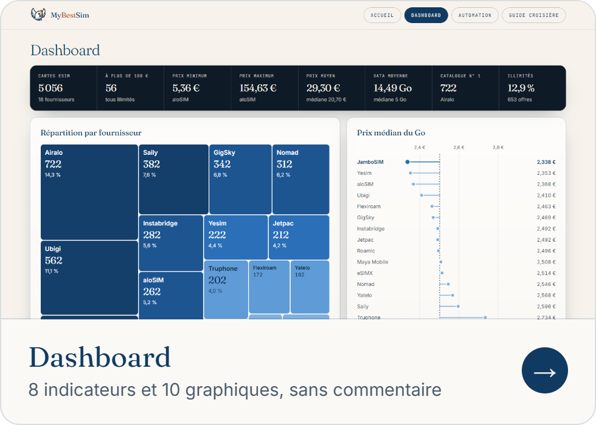
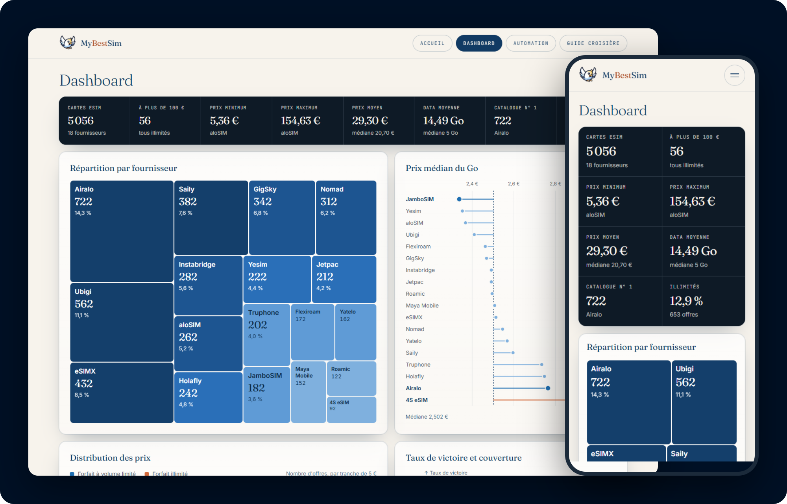
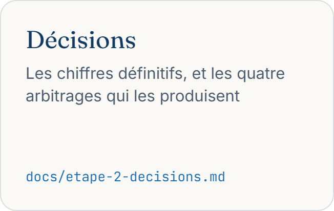
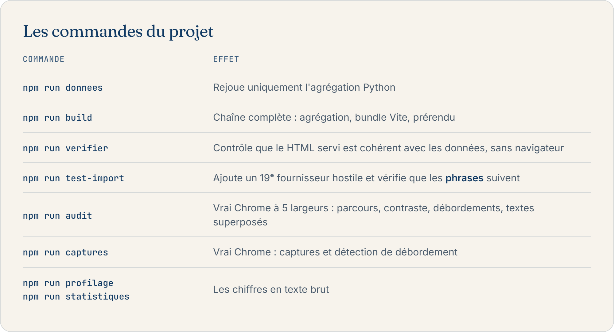
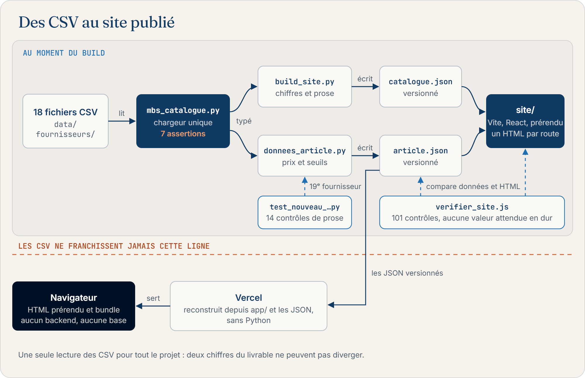
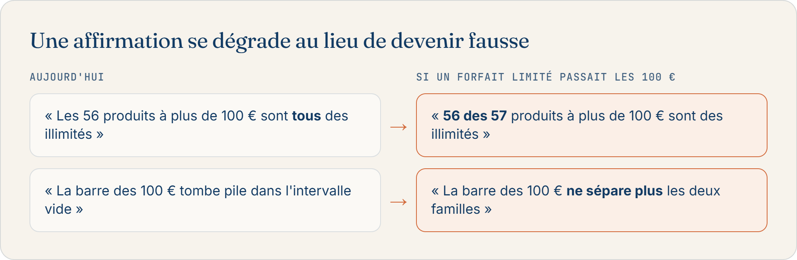
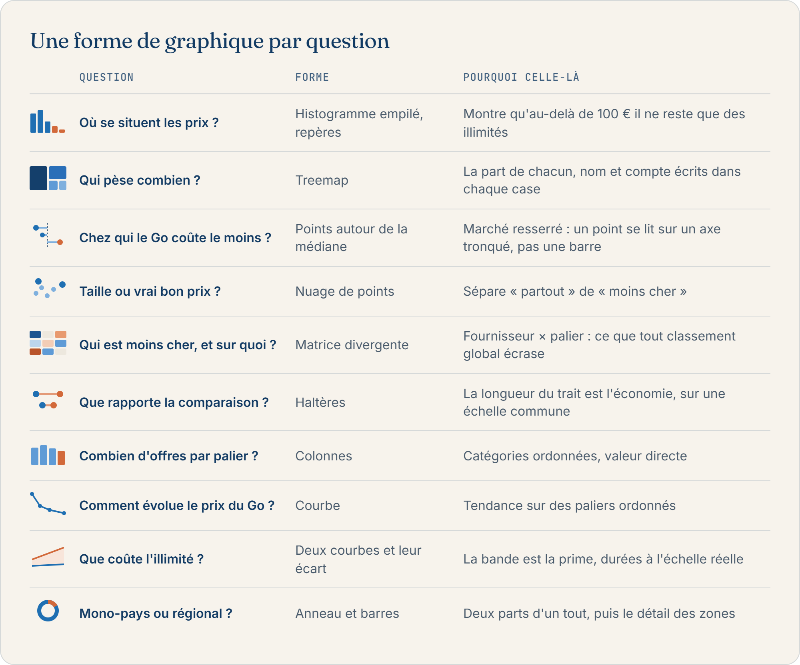
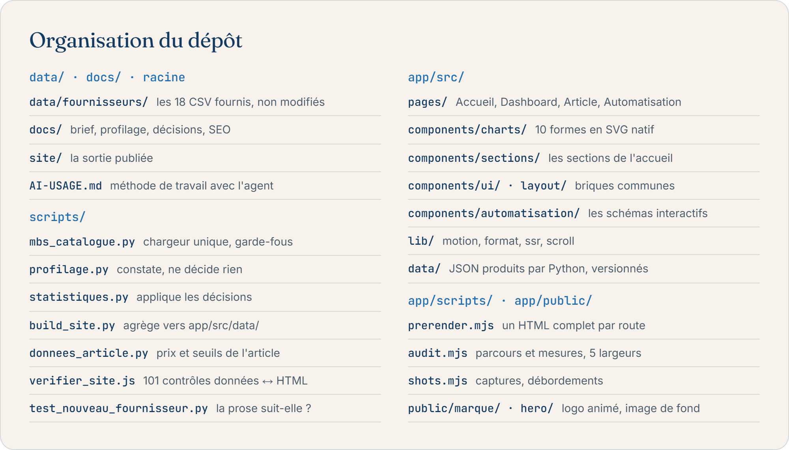

<p align="center">
  
</p>

<p align="center">
  <a href="https://github.com/princeamir56/mybestsim-test/actions/workflows/pipeline.yml"></a>
  
  
  
  
  
</p>

Deux livrables : un tableau de bord du catalogue eSIM, et un article SEO. Ce dépôt contient les
deux, et surtout **la trace de comment ils ont été construits**.

**Amir Kerkeni**, étudiant ingénieur en dernière année, Business Intelligence et Génie Logiciel.

<p align="center">
  <a href="https://mybestsim-test.vercel.app/dashboard"></a>
  <a href="https://mybestsim-test.vercel.app"></a>
</p>
<p align="center">
  <a href="https://mybestsim-test.vercel.app/internet-en-croisiere"></a>
  <a href="https://mybestsim-test.vercel.app/automation"></a>
</p>

<p align="center">
  
</p>

**Sommaire :** [À lire en premier](#à-lire-en-premier) · [Démarrage](#démarrage) ·
[Architecture](#architecture) · [Automatisation](#lautomatisation) ·
[Conception visuelle](#conception-visuelle) · [Mise en ligne](#mise-en-ligne) ·
[Organisation du dépôt](#organisation-du-dépôt) · [Méthode](#méthode)

---

## À lire en premier

<p align="center">
  <a href="docs/etape-1-profilage.md"></a>
  <a href="docs/etape-2-decisions.md"></a>
  <a href="AI-USAGE.md"></a>
</p>

Si vous ne devez regarder qu'une commande : **`npm run test-import`** ajoute un 19ᵉ fournisseur
fictif et vérifie que le livrable *change d'avis* au lieu de répéter ses conclusions de la veille.

Pour vérifier les chiffres : [docs/profilage-sortie.txt](docs/profilage-sortie.txt),
[docs/etape-2-chiffres.txt](docs/etape-2-chiffres.txt),
[docs/etape-4-recherche-seo.md](docs/etape-4-recherche-seo.md).

---

## Démarrage

```bash
pip install -r requirements.txt      # pandas
npm install && npm --prefix app install

npm run build                        # CSV → JSON → site statique dans site/
npm run verifier                     # 101 contrôles sur le HTML réellement servi
npm run test-import                  # simule un 19ᵉ fournisseur et contrôle la prose
npm run preview                      # http://localhost:4173
```

<p align="center">
  
</p>

---

## Architecture

Le brief impose un livrable **en ligne, ouvrable dans un navigateur sans rien installer**. J'en
tire une contrainte que tout le reste respecte :

> **Les CSV ne sont jamais lus par le navigateur.** Python les agrège **au moment du build** en un
> JSON, que Vite empaquette dans le bundle. Pas de backend, pas de base, aucun appel réseau vers
> les données.

<p align="center">
  
</p>

### Un seul point d'entrée pour les données

[`scripts/mbs_catalogue.py`](scripts/mbs_catalogue.py) est l'**unique** chargeur : profilage,
statistiques, JSON du tableau de bord et tableau de prix de l'article l'utilisent tous. Il embarque
sept assertions qui **font échouer le build** plutôt que de laisser passer un chiffre faux, dont
celle qui garde le piège le plus coûteux du jeu de données :

```python
assert (df["country_code"] == "NA").any(), \
    "aucun country_code 'NA' : pandas les a convertis en NaN (keep_default_na)"
```

### Aucun chiffre en dur, pas même dans les phrases

Le brief décrit un import **quotidien**. Un dépôt qui ne tient que sur l'instantané du jour n'est
donc pas une réponse au brief, c'est une maquette.

Les chiffres étaient déjà calculés. Le danger était ailleurs : **la phrase qui commente le chiffre,
parce que personne ne la recalcule.** Écrite en dur, elle aurait rendu le projet inautomatisable :
un 19ᵉ fournisseur aurait changé les graphiques sans changer le texte, et le livrable se serait mis
à mentir tout seul.

La prose de l'accueil est donc produite par [`faits()`](scripts/mbs_catalogue.py), qui calcule ce
que les phrases *affirment* :

```python
"chers_tous_illimites": bool(len(chers) and chers["illimite"].all()),
```

<p align="center">
  
</p>

**Ce n'est pas seulement le nombre qui bascule, c'est l'argument.** `npm run test-import` le
vérifie sur un 19ᵉ fournisseur construit pour démentir chaque affirmation de l'accueil : 14
contrôles, code de sortie non nul en cas d'échec.

La même règle vaut pour les conseils de l'article. À partir de combien de pays une eSIM régionale
bat-elle les eSIM locales ? `multi_pays()`, dans
[`donnees_article.py`](scripts/donnees_article.py), le calcule depuis les prix, et chaque phrase lit
ce résultat.

### Le vérificateur ne connaît aucune valeur attendue

[`verifier_site.js`](scripts/verifier_site.js) charge `catalogue.json` et `article.json`, et
contrôle la **cohérence** entre les données et la page, un invariant qui reste vrai quel que soit
l'import :

- les six statistiques du brief, lues dans le JSON et cherchées dans le HTML ;
- **chaque champ de chaque arbitrage** (`retenu`, `pourquoi`, `alternative`) retrouvé mot pour mot
  dans le HTML servi ;
- les pièges, les limites, les prix de l'article, le nom de chaque fournisseur ;
- les conseils de l'article : le seuil local / régional calculé est repris partout, et aucune
  phrase n'en annonce un autre ;
- `/dashboard` : les indicateurs et tous les fournisseurs présents, aucun paragraphe explicatif.

101 contrôles, aucune valeur attendue écrite en dur.

### La preuve de bout en bout

```bash
cp /chemin/vers/un-19e-fournisseur.csv data/fournisseurs/
npm run build && npm run verifier     # doit passer : rien n'est figé
rm data/fournisseurs/un-19e-fournisseur.csv && npm run build
```

### Pourquoi un prérendu, puisque c'est une application React ?

[`app/scripts/prerender.mjs`](app/scripts/prerender.mjs) écrit un fichier HTML complet par route,
via `renderToString` :

1. **L'article est un livrable SEO.** Son contenu doit être dans le code source servi, pas injecté
   après coup.
2. **Un hébergement statique ne connaît pas les routes du client** : sans fichier à
   `/internet-en-croisiere/`, l'URL renvoie un 404 avant que React ne démarre.
3. **Sans JavaScript, les pages restent entièrement lisibles.**

---

## L'automatisation

<p align="center">
  
</p>

La page [`/automation`](app/src/pages/Automatisation.jsx) rejoue le workflow réel sur un schéma
interactif : quatre scénarios, un paquet qui change de nature à chaque étape, un journal
d'exécution, et le détail de chaque brique au clic. Le contenu décrit
[`pipeline.yml`](.github/workflows/pipeline.yml) tel qu'il est, et le vérificateur recoupe les
totaux annoncés avec le code.

La même page présente la **suite possible du projet** : un workflow n8n simulé, qui prendrait en
charge ce que le pipeline ne fait pas encore (aller chercher les fichiers, écarter les mauvais,
confirmer la publication). **Il n'est pas déployé**, et la page le dit explicitement.

---

## Conception visuelle

Le système reprend celui de mes autres projets (Nostra, HB Travel, Huilerie Zouyout Alchifa) :
papier chaud, une famille de bleus, **un seul accent** réservé aux appels à l'action, serif
d'affichage contre sans-serif de texte, et du mono pour *tout ce que le catalogue mesure plutôt
qu'il ne le dit*.

**Les couleurs des graphiques ont été validées avant d'écrire la moindre ligne de CSS** : bande de
luminosité, plancher de chroma, séparation protan/tritan et contraste. Conséquence de forme :
**jamais dix-huit couleurs pour dix-huit fournisseurs.**

Aucune librairie : chaque graphique est écrit pour ce projet, en SVG dessiné au pixel réel, avec
son info-bulle au survol et au tap, et son état final écrit dans le HTML prérendu.

<p align="center">
  
</p>

**Mouvement** : une seule courbe pour tout le site, `prefers-reduced-motion` respecté partout, et
l'effet magnétique désactivé au doigt.

**La scène d'ouverture** : le corps et les ailes de l'oiseau sont trois pièces découpées dans le
logo. Elle se joue une fois par session, uniquement à l'arrivée sur l'accueil, et **jamais sur
l'article**, page d'atterrissage SEO où un rideau retarderait le plus grand affichage que Google
mesure.

<p align="center">
  
</p>

Le texte ne dépend jamais de l'image pour rester lisible. L'image pèse de 52 à 111 Ko selon la
taille servie.

**Le schéma de couverture de l'article** est une animation en boucle de 5 s écrite en SVG et en
CSS, pas en fichier vidéo : il reste dans le HTML servi, net à toute taille, sans téléchargement
supplémentaire.

---

## Mise en ligne

**Vercel** : le projet a `app` pour Root Directory, et [`app/vercel.json`](app/vercel.json)
s'applique. Python n'est **pas** nécessaire sur Vercel, car les JSON agrégés sont versionnés.

L'URL publique alimente les balises canoniques, `robots.txt` et le sitemap. Elle est résolue dans
cet ordre :

1. `SITE_ORIGIN`, si la variable est posée ;
2. `VERCEL_PROJECT_PRODUCTION_URL`, que Vercel expose au build ;
3. un repli, pour que le build local ne casse pas.

> L'accueil, le dashboard et l'automatisation sont volontairement en `noindex` : seul l'article a
> vocation à ranker, et un contrôle verrouille ce choix.

---

## Organisation du dépôt

<p align="center">
  
</p>

Les CSV et le PDF du brief sont **volontairement versionnés** : sans eux, le dépôt n'est pas
reproductible.

---

## Méthode

<p align="center">
  
</p>

L'ordre n'est pas décoratif : **aucun travail de mise en forme n'a été engagé avant que les chiffres
soient validés.** Un tableau de bord soigné construit sur des chiffres faux est la seule erreur
qu'on ne rattrape pas. Le déroulé complet est consigné dans [AI-USAGE.md](AI-USAGE.md).
